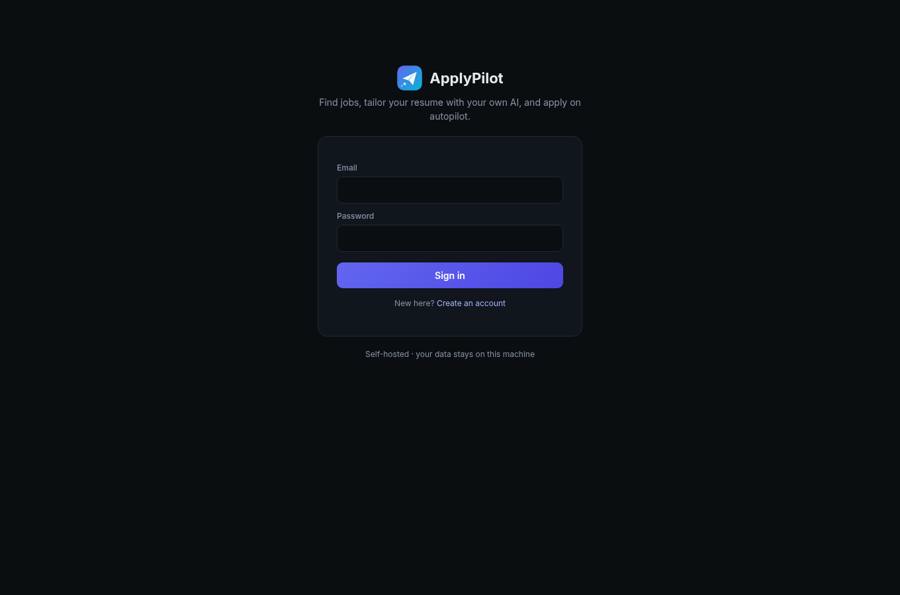
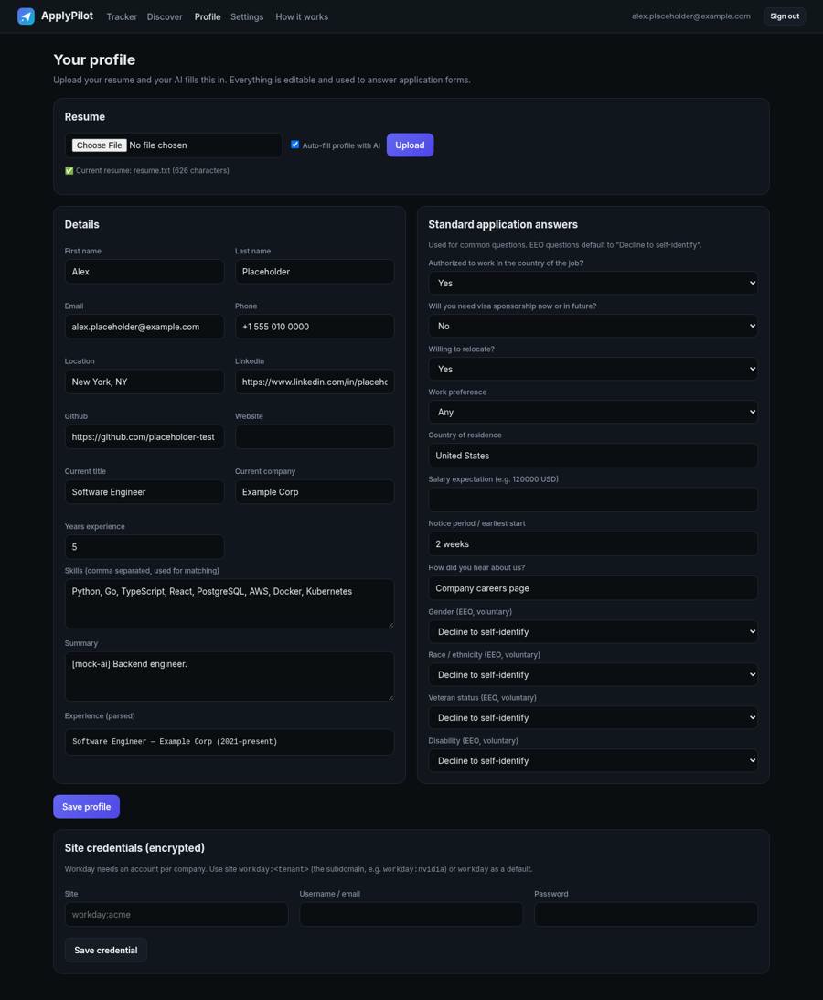
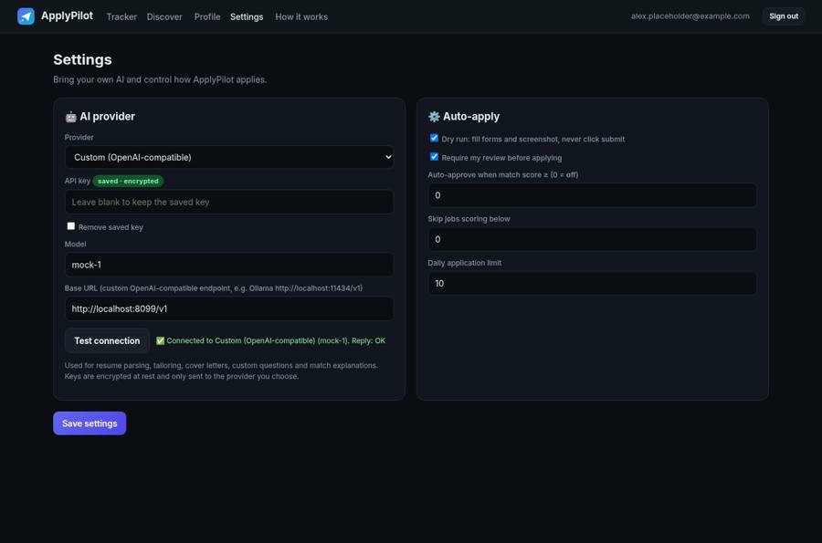
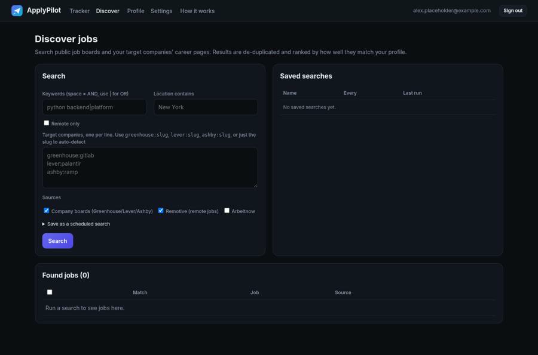
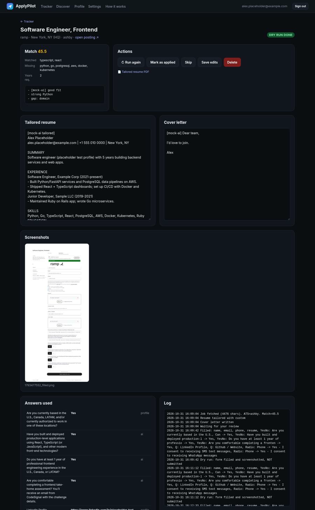
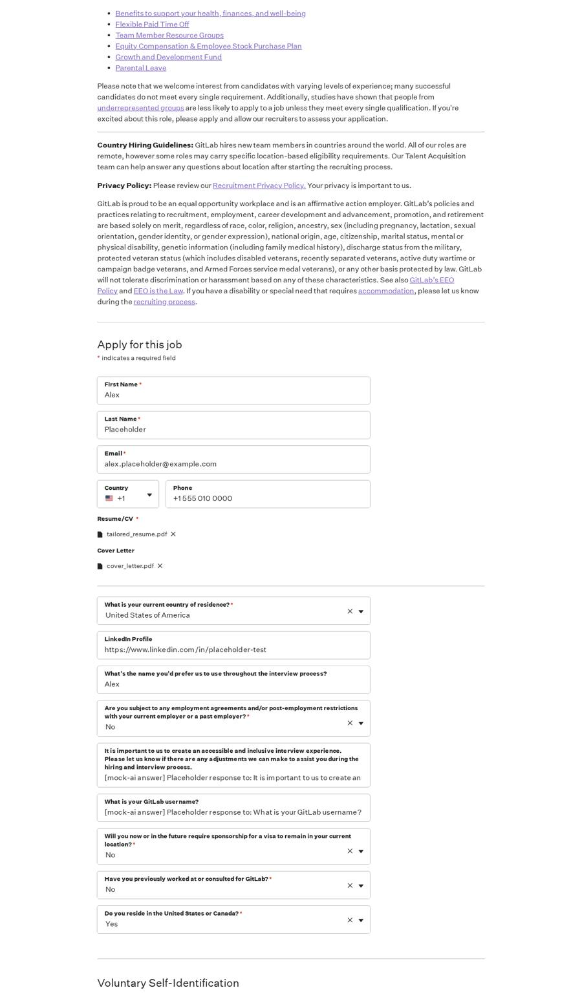
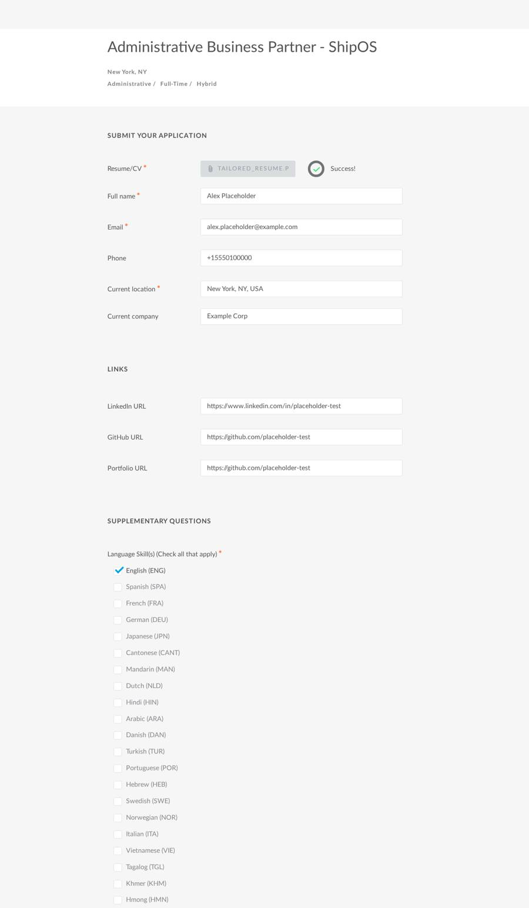
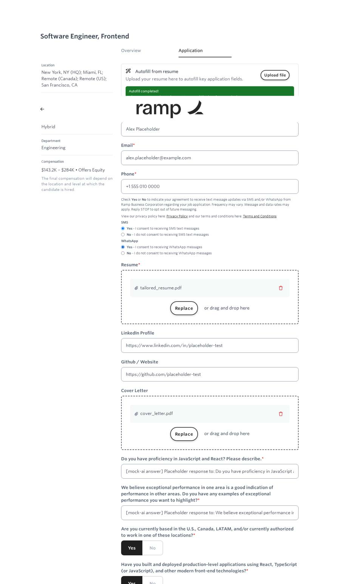
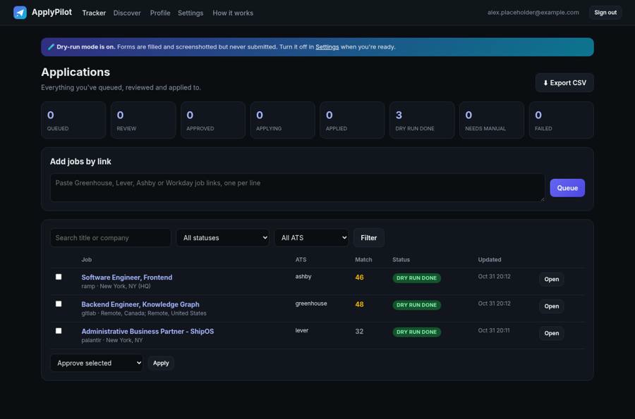

# Quick start

## 1. Install and start
Use Docker (`docker compose up --build`) or the scripts (`bash install.sh && bash start.sh`, or `install.ps1` / `start.bat` on Windows). Then open **http://localhost:8077**.

## 2. Create your account
Sign up with email and password, or use **Continue with Google** if it's configured (see README).

## 3. Upload your resume and check your profile
On **Profile**, upload a PDF or DOCX. With *Auto-fill profile with AI* ticked, your AI extracts your name, contact details, skills, years of experience, work history and education. Check the fields, then fill in **Standard application answers**: work authorization, sponsorship, relocation, salary, notice period, how you heard, and the EEO questions, which default to *Decline to self-identify*. For Workday, add a credential such as `workday:acme`.

## 4. Connect your AI
In **Settings**, choose Grok, Gemini, Claude, OpenAI or a custom OpenAI-compatible endpoint. Paste your key, then click **Test connection**. Leave **Dry run** and **Require review** on while you try things out.

## 5. Find jobs
On **Discover**, enter keywords and the companies you want, for example `greenhouse:gitlab`, `lever:palantir` or `ashby:ramp`. Remotive (remote jobs) and Arbeitnow can also be searched. Results are ranked by match score. Tick jobs and choose **Queue**. You can also save the search to run every N hours and auto-queue strong matches.

You can also paste any Greenhouse, Lever, Ashby or Workday link on the **Tracker**.

## 6. Review and approve
Each queued job is fetched, scored and tailored: a resume PDF and a cover letter are written by your AI. It then waits in **REVIEW**. Open it, edit anything, and click **Approve & apply**.

## 7. Watch it apply
The worker opens a real browser and fills the form, including uploads, dropdowns, radio buttons, checkboxes and custom questions. In dry-run you get a full-page screenshot like these, with nothing submitted:

| Greenhouse | Lever | Ashby |
|---|---|---|
|  |  |  |

When you're happy, turn **Dry run** off in Settings. Real submissions respect your daily limit. If a CAPTCHA or an unanswerable required field appears, the job becomes **NEEDS MANUAL** with a link so you can finish it yourself.

## 8. Track everything
The **Tracker** shows counts per status, filters, bulk actions and **Export CSV**.

